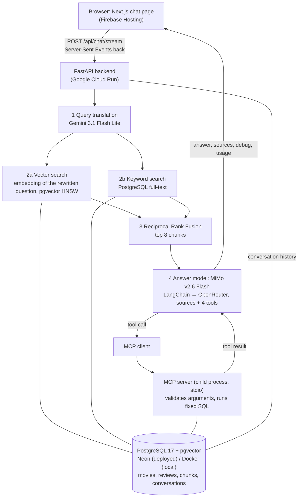
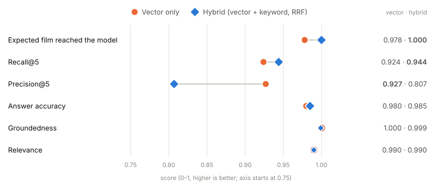

# Movie Research Copilot

A movie research chatbot that answers from about 10,000 real critic reviews and the films' metadata instead of the
model's memory. Ask "What did critics say about Black Swan?", "Which is rated higher, Zodiac or Prisoners?" or
"Recommend a well-rated thriller from the 2010s". Every answer shows the reviews it used, what retrieval did, which
tools ran and what the answer cost.

**Live demo:** https://ai-devops-508221.web.app. The first question after a quiet spell can take about 30 s while the
backend and database wake up; after that, the first words appear in about 5 s.

**Contents:** [What it does](#what-it-does) · [Architecture](#architecture) · [Stack](#stack) ·
[How a question is answered](#how-a-question-is-answered) · [Tools](#tools) ·
[Vector-only vs hybrid search](#vector-only-vs-hybrid-search) · [Evaluation](#evaluation) · [Security](#security) ·
[Key decisions](#key-decisions) · [Limitations and next steps](#limitations-and-next-steps) ·
[Installation](#installation) · [Tests](#tests)

## What it does

General chatbots answer movie questions from memory: they mix films up, invent quotes and can't say where a claim
came from. I built a research assistant that works the other way round:

- **Grounded answers.** It retrieves the relevant critic reviews and film profiles (RAG) and answers only from them,
  saying so when the evidence isn't there.
- **Exact facts from the database.** Ratings, comparisons, filters and credits come from SQL through tools, never from
  the model's memory.
- **Transparent.** Under each answer: the sources with links to the original reviews, a "RAG process" panel (the
  rewritten query, vector and keyword results, the fusion), the tool calls with their results, and tokens and cost.
- **Measured.** A 49-question evaluation set checks retrieval and answers; every number here comes from a real run.

Data: 9,987 English Rotten Tomatoes critic reviews of 500 films, joined to TMDB/IMDb metadata (director, cast,
runtime, IMDb rating, overview, keywords). Details in [`docs/dataset.md`](docs/dataset.md).

## Architecture



Offline, once: Hugging Face files → select the subset → ingest into PostgreSQL → build and chunk documents → embed
every chunk into pgvector (`scripts/`). Deployment steps: [`docs/deployment.md`](docs/deployment.md).

## Stack

| Layer | Choice | Why |
|---|---|---|
| Frontend | **Next.js**, TypeScript, Tailwind | Static export hosted for free; reads the answer stream with `fetch`, renders Markdown without raw HTML |
| Backend | **FastAPI**, Pydantic | Validates every request and response body; streams the answer as Server-Sent Events |
| LLM orchestration | **LangChain** | Tool binding, structured output for query translation, the text splitter, callbacks for tokens and cost |
| Model access | **OpenRouter** | One OpenAI-compatible API for every model; it reports the real cost of each call |
| Answer model | `xiaomi/mimo-v2.6-flash` | The most accurate model I compared, cheap, supports tool calling |
| Query translation | `google/gemini-3.1-flash-lite` | Fast, and the most accurate of the small models I compared (16/16) |
| Embeddings | `openai/text-embedding-3-small` (1,536 dims) | Same model for chunks and questions, so their vectors are comparable |
| Database | **PostgreSQL** 17 + **pgvector** (HNSW, cosine), Alembic | Data, vectors, full-text search and conversations in one database |
| Tools protocol | **MCP** Python SDK | The 4 tools run behind a standard protocol in their own process |
| Hosting | Firebase Hosting, Cloud Run, Neon, Secret Manager | Free tiers, scale to zero, secrets never in the image or the repo |

## How a question is answered

1. **History.** The last 6 messages of the conversation are loaded, so a follow-up like "who directed it?" makes sense.
2. **Query translation** (`query_translation.py`). One structured-output LLM call rewrites a casual question ("joker
   movie with heath ledger, why is everyone obsessed") into `{"semantic_query", "keywords", "filters", "movies"}`. Only
   retrieval uses the rewrite; the answer is written for the user's own words. If anything fails, the original
   question is used.
3. **Retrieval** (`retrieval.py`, `fusion.py`):
   - *Vector search:* the `semantic_query` is embedded and pgvector returns the 10 chunks closest in meaning.
   - *Keyword search:* PostgreSQL full-text search returns the 10 chunks containing the keywords as phrases, which
     catches exact names that embeddings blur.
   - *Fusion:* Reciprocal Rank Fusion scores each chunk by its rank in both lists, Σ 1 / (60 + rank), and the top 8
     go to the model. When a question names two or more films, each film is searched separately and gets an equal
     share, so a comparison sees evidence for both.
4. **Generation** (`tool_calling.py`). The prompt holds the rules, the history, the 8 chunks inside
   `<source chunk_id=… movie=…>` tags and the question. The rules: answer only from the sources, say when they are not
   enough, report what critics say instead of giving a verdict, use a tool for any exact fact. The model may call tools
   for up to 3 rounds before it answers.
5. **Response.** The answer streams to the page token by token, then the sources, the debug object and the usage. The
   exchange is stored for follow-ups and one JSON line goes to the request log.

**Chunking** (`documents.py`): one *review* document per critic review and one *profile* document per film. Bodies are
split with LangChain's `RecursiveCharacterTextSplitter` at 1,000 characters with 150 overlap; reviews (at most about
360 characters) stay whole, long profiles are split, and the title header is repeated on every chunk. 10,540 chunks.

## Tools

The model decides when to call a tool; my code validates the arguments with Pydantic and runs a fixed, parameterised
SQL query (`tools.py`, served by `mcp_server.py`).

| Tool | Arguments | Returns | Example question |
|---|---|---|---|
| `filter_movies` | `year_min`, `genre`, `rating_min` (at least one), `limit` | best matches by IMDb rating, plus how many matched | "Well-rated thrillers since 2010?" |
| `compare_movies` | `movie_a`, `movie_b` | year, IMDb rating, genres, review count, which is rated higher | "Which is rated higher, Zodiac or Prisoners?" |
| `rating_summary` | `movie` | average critic score (0–10), number of reviews, distribution | "How did critics score Black Swan?" |
| `get_movie_metadata` | `movie` | director, writers, cast, runtime, genres, IMDb rating, overview | "Who directed Prisoners?" |

Errors go back to the model instead of being raised: `MOVIE_NOT_FOUND` (with suggestions), `AMBIGUOUS_TITLE` (with
candidates, e.g. *Beauty and the Beast* 1991 and 2017), `INVALID_ARGUMENTS`, `TOOL_FAILED`.

**Tool calling vs MCP.** Tool calling is the model asking for a function by name with arguments; the model never runs
anything. MCP is how those functions are offered: a separate server process lists them with their JSON schemas and runs
them when asked, over a standard protocol. If the MCP server can't start or a call fails, the same functions run inside
the backend and the answer carries a warning.

## Vector-only vs hybrid search

I ran the full 49-question evaluation twice per strategy with the same code, data and models; only the retrieval
strategy changed (`RETRIEVAL_STRATEGY=vector` or `hybrid`).



| Metric | Vector only | Hybrid |
|---|---|---|
| Expected film reached the model | 0.978 | **1.000** |
| Recall@5 | 0.924 | **0.944** |
| Precision@5 | **0.927** | 0.807 |
| Answer accuracy | 0.980 | 0.985 (0.980–0.990 over two runs) |
| Groundedness | 1.000 | 0.999 |
| Relevance | 0.990 | 0.990 |
| Average latency | 7.1 s | 9.0 s |
| Average cost per answer | $0.0007 | $0.0006 |

What it shows:

- **Retrieval: hybrid is better.** It found the expected film for every question (vector missed one) and has higher
  recall. Keyword search catches exact names and titles that embeddings blur.
- **The price is precision.** Keyword search also brings in reviews of other films that share a name or a term, so
  more off-topic chunks reach the model. The model treats them as extra sources and mostly ignores them.
- **Answers: equal within noise.** The same question can score 0.5 in one run and 1.0 in the next, so a difference
  of one question is not evidence. That's why each strategy ran twice.
- **Hybrid stays the default.** Better retrieval, no measurable loss in answers, negligible extra cost.

An earlier comparison on 54 separate tuning questions found the biggest gain on two-film questions: both films
reached the model in 6 of 8 cases with hybrid against 3 of 8 with vector only. Searching each named film separately
later closed the remaining gap. Results: [`evaluation/results/final2/summary.json`](evaluation/results/final2/summary.json),
[`docs/experiments/hybrid_comparison.json`](docs/experiments/hybrid_comparison.json).

## Evaluation

**Dataset:** 49 questions written only for evaluation ([`evaluation/evaluation_dataset.jsonl`](evaluation/evaluation_dataset.jsonl)):
8 factual, 7 rating, 8 opinion, 8 plot, 5 recommendation, 9 two-film comparisons and 4 about films that are not in
the data. Every expected answer was read from the database.

**Metrics** ([`evaluation/run_evaluation.py`](evaluation/run_evaluation.py)):

- *Retrieval*, with no LLM: did the expected film reach the model, Recall@5/@8, Precision@5.
- *Answers*, judged by Claude Haiku 4.5 (a different company's model from the ones answering), which sees exactly the
  sources and tool results the system saw: correctness (1 / 0.5 / 0), relevance, and groundedness checked claim by claim.
- *Speed and cost* from the system's own timings and OpenRouter's reported cost.

Every question type scores 1.0 except comparisons (0.94) and recommendations (0.95). The misses: "Is *Black Swan* more
disturbing than *Hereditary*?" (the reviews don't settle it, judged half right) and an animated-family list that
included *Spider-Man: Into the Spider-Verse*, which the data doesn't tag as a family film.

**What changes quality, speed and cost** (one setting changed per experiment; [`evaluation/results/analytics.json`](evaluation/results/analytics.json)):

| Experiment | Result |
|---|---|
| Where the time goes | Answer generation 81 % of the median 5.5 s, query translation 12 %, embedding + vector search 7 %, keyword search ~0 % |
| Query translation off | Expected film reached the model 1.000 → 0.933, answer accuracy 0.985 → 0.949; saves ~1 s and $0.30 per 1,000 answers. Worth keeping |
| 5 / 8 / 10 chunks | Accuracy 0.980 / 0.985 / 0.990, cost per 1,000 answers $0.71 / $0.67 / $0.75: differences within noise, because reviews are short and fixed prompt parts dominate. 8 stays |
| Answer model | MiMo 0.985 accuracy (median 5.5 s, $0.67 per 1,000); GPT-6 Luna 0.949 (4.3 s, $0.63); Gemini Flash Lite 0.948 (3.5 s, $1.38). MiMo stays: correctness first, streaming hides most of the wait |
| Deployed site, cold vs warm | First words after 33 s cold (container start and imports 16.7 s, MCP server 5.1 s, then the database waking) vs 5.5 s warm |

All evaluation runs together cost $2.45; 87 % of that was the judge.

## Security

Retrieved reviews are text written by strangers, and the model reads them, so they are untrusted data (prompt
injection). The defences, in layers:

- **Prompt rules:** sources are data only and instructions inside them are never followed; off-topic requests are
  declined in a sentence or two, with no code or commands.
- **Isolated sources:** each chunk sits in `<source>` tags with `<` escaped, so a review can't close its tag or fake a
  question. The user's message and tool results are escaped the same way.
- **Tools for facts:** exact numbers come from SQL, so a review that plants a false rating is overruled.
- **No SQL from model text:** fixed query shapes with bound parameters; tool arguments are validated (types, lengths,
  control characters) in the backend and again in the MCP server.
- **No secrets where the model or a visitor can see them:** keys come from environment variables (Secret Manager when
  deployed), never in prompts, responses, logs or the frontend.
- **Public limits:** 10 questions per visitor per minute, 200 per day in total, 2,000 characters per question, 3 tool
  rounds, 90 s per question.

I tested it with 8 live attacks (5 poisoned reviews inserted into the database, 3 hostile user messages): all were
defended after one prompt fix ([`docs/experiments/prompt_injection_results.json`](docs/experiments/prompt_injection_results.json),
`python scripts/injection_tests.py`).

## Key decisions

The options I compared and the numbers behind each choice are in [`docs/project_log.md`](docs/project_log.md).

- **PostgreSQL + pgvector instead of a separate vector database.** Vectors sit next to the movies and reviews they
  describe, the tools query the same tables, and full-text search for hybrid retrieval is built in. HNSW gives
  approximate search in ~5 ms instead of ~72 ms, with the same top 8 on 200 real queries.
- **Two document types.** A review document per critic review for opinions, and a profile document per film for facts
  like cast and plot, so both kinds of question find something to retrieve.
- **text-embedding-3-small.** I compared it with Qwen3-Embedding-8B on 30 known-answer questions. Qwen ranked the right
  film first more often (29 vs 26), but it was 3.7× slower per question, and with 8 chunks per answer OpenAI already
  had the right film in the context for 29 of 30.
- **A separate, small model for query translation.** Gemini Flash Lite rewrites the question in about a second; the
  slower, more accurate MiMo writes the answer.
- **Hybrid search with Reciprocal Rank Fusion.** RRF combines ranks, not scores, so vector distances and full-text
  ranks don't need to be on the same scale.
- **No router in front of the tools.** Every question gets the sources and the tools, and the model decides. Simpler,
  and it works for questions that need both.
- **Report what critics say, no verdict of its own.** Adding this rule cut answers with an unsupported claim from 3 of
  21 to 1 of 21 on the questions where it mattered.
- **Neon + Cloud Run + Firebase Hosting.** The same PostgreSQL + pgvector as locally, managed and free at this size,
  with scale-to-zero hosting. The cost is a slow first answer after an idle period.

## Limitations and next steps

- **Small dataset:** 500 films and about 10,000 reviews. Scaling to 50k–100k+ reviews is the obvious next step; the
  pipeline is idempotent, but embedding and the free database tier set the limit.
- **Data quality:** the metadata includes at least one TV series (*Vikings*) listed as a film; filtering by runtime or
  title type when selecting the subset would remove such rows.
- **Lower precision with hybrid search:** names like "Toy Story" also match the sequels and crowd out other films.
  Re-ranking the fused results would help.
- **Filters are extracted but not applied:** query translation produces year and genre filters, but retrieval doesn't
  use them yet; the `filter_movies` tool covers those questions for now.
- **Injection tests need refreshing:** hybrid search no longer retrieves 3 of the 5 poisoned reviews, so those attacks
  no longer reach the model. Their questions need rewriting.
- **Cold start:** about 33 s to the first words after an idle period. `--cpu-boost` or one always-on instance would
  fix it, at a cost.
- **Rate limits live in memory per instance,** so with 2 instances the real limit is up to twice the setting. A shared
  store (e.g. Redis) would fix that; for a demo, the OpenRouter key's credit limit is the real ceiling.
- **Answer scores vary between runs.** More runs per setting, or a larger evaluation set, would make small differences
  measurable.

## Installation

**Prerequisites:** [uv](https://docs.astral.sh/uv/) (it installs Python 3.11 itself), Node.js 20+, Docker Desktop and an
[OpenRouter](https://openrouter.ai) API key.

Install uv if you don't have it:

```bash
# Windows (PowerShell)
powershell -ExecutionPolicy ByPass -c "irm https://astral.sh/uv/install.ps1 | iex"
# macOS / Linux
curl -LsSf https://astral.sh/uv/install.sh | sh
```

**1. Clone the repository.** On Windows, use a short folder path (for example `C:\dev\RAG`): one LangChain package
has file paths long enough to hit Windows' 260-character limit inside a deeply nested folder.

```bash
git clone https://github.com/everyonehatesLin3lis/RAG.git
cd RAG
```

**2. Set the secrets** (never committed):

- copy `.env.example` to `.env` and set `POSTGRES_PASSWORD`;
- copy `backend/.env.example` to `backend/.env`, set `OPENROUTER_API_KEY`, and put the same password into
  `DATABASE_URL`.

**3. Start the database** (PostgreSQL 17 + pgvector in Docker, on port 5433):

```bash
docker compose up -d
```

**4. Install the backend with uv** and create the tables:

```bash
cd backend
uv venv --python 3.11
.venv\Scripts\activate          # macOS / Linux: source .venv/bin/activate
uv pip install -r requirements.txt
alembic upgrade head
```

`requirements.txt` installs everything for development: the runtime packages in `requirements-runtime.txt` (all the
deployed container needs) plus `datasets`, `pytest` and `httpx`.

**5. Load the data** (from the repo root, with the backend environment still active). The download is about 670 MB,
and embedding costs money (about $0.02 for all 10,540 chunks), so look at the dry run first:

```bash
python scripts/download_datasets.py
python scripts/select_subset.py
python scripts/ingest.py
python scripts/embed_chunks.py --dry-run
python scripts/embed_chunks.py
```

**6. Run the backend** (it starts the MCP server itself):

```bash
cd backend
uvicorn app.main:app --reload --port 8000
```

**7. Run the frontend** in a second terminal:

```bash
cd frontend
npm install
npm run dev
```

Then open http://localhost:3000 and ask a question.

## Tests

```bash
cd backend
pytest                 # 359 tests, about 20 s, no API calls
pytest -m security     # one group: backend, rag, tools, security, mcp
pytest -m live         # 13 tests with the real models, about $0.02
```

| Group | Tests | What it covers |
|---|---|---|
| backend | 170 | every API route, streaming, error handling, history, schema, vector and keyword search, fusion, usage, logging |
| rag | 43 | known, vague and no-answer questions against the real database, the prompt rules, the debug object |
| tools | 69 | all four tools with valid and invalid arguments, missing and duplicate titles, the tool-calling loop |
| security | 63 | hostile tool arguments in-process and through MCP, injected tags in reviews, messages and tool results, no secrets in errors |
| mcp | 14 | discovery, every tool and error code through MCP, the stdio child process |

A guard in `conftest.py` fails any test that would make a paid API call; the RAG tests replay a recorded translation
and embedding on the real database, inside a transaction that is rolled back.

## Repository layout

```text
frontend/     Next.js chat app
backend/      FastAPI app (app/), Alembic migrations (migrations/), tests (tests/)
scripts/      download, select, ingest, embed, injection tests, monitoring
evaluation/   evaluation dataset, runner, reports and results
docs/         dataset notes, deployment guide, development notes, experiments
deploy/       Cloud Run settings (no secrets)
specs/        acceptance criteria for the test-first parts
```
